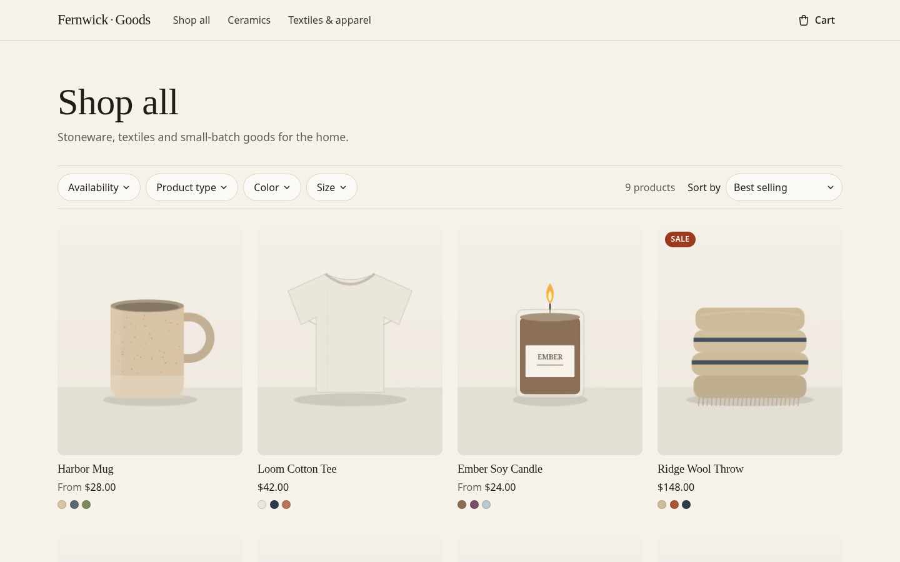
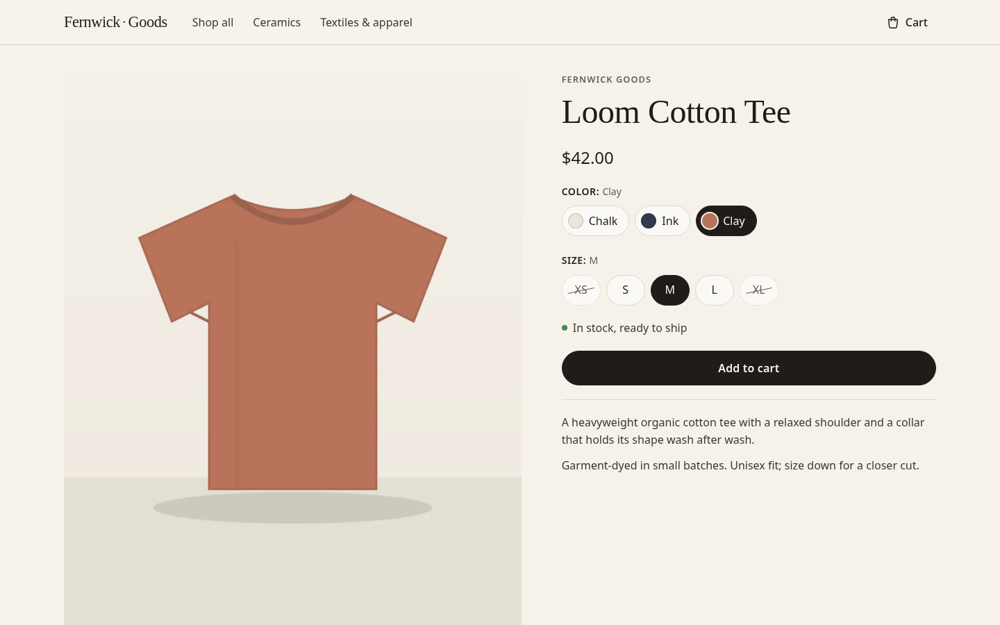
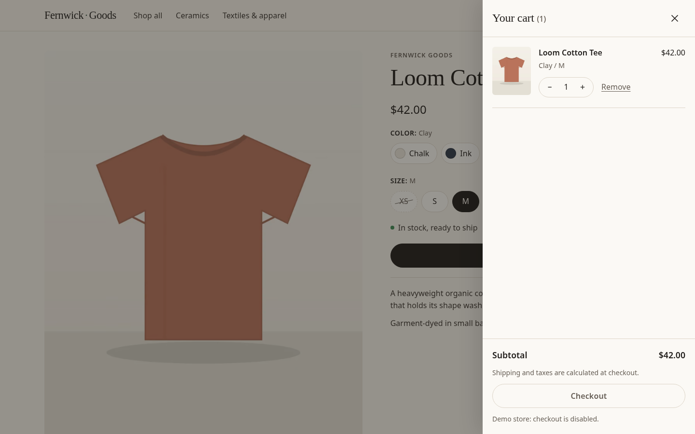
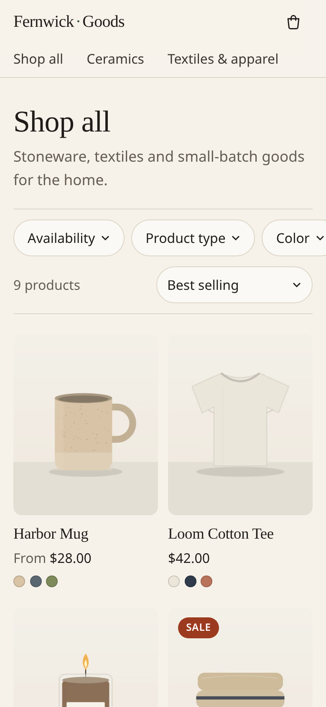
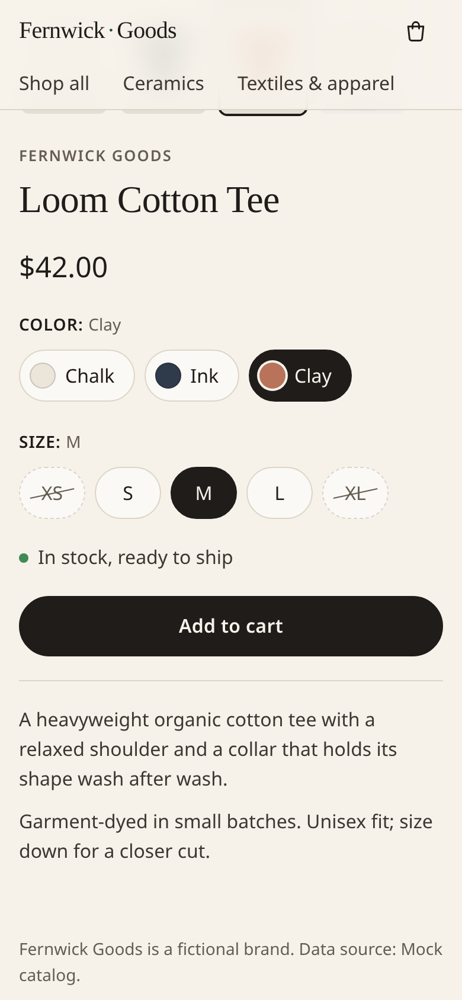
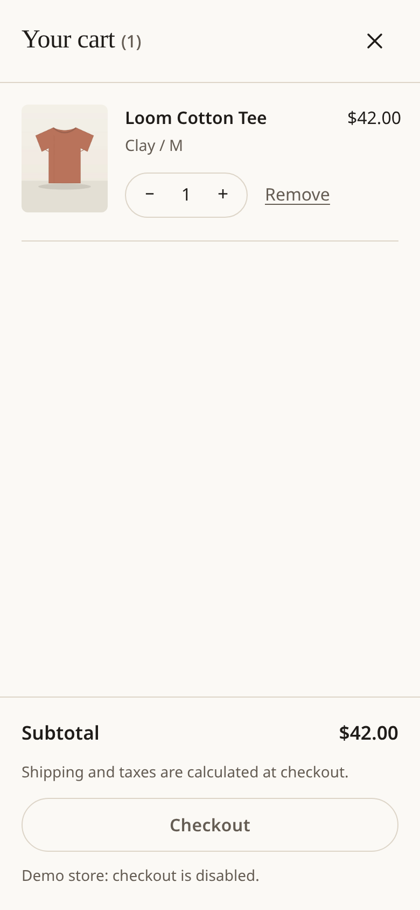
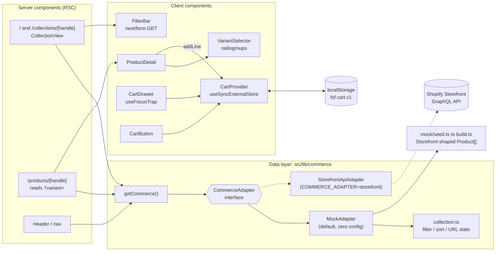

# shopify-fast-storefront

**A small headless storefront on Next.js 16 (App Router) with accessible variant picking and a keyboard-safe cart drawer. The data comes from Shopify Storefront API–shaped responses, so the synthetic catalog can be swapped for a real store without touching a component.**


It runs with zero configuration on a synthetic catalog for **Fernwick Goods**, a made-up homewares brand. Every product image is original artwork, generated by a script in this repo.

| | Collection | Variant selection | Cart drawer |
| --- | --- | --- | --- |
| **Desktop** (1440px) |  |  |  |
| **Mobile** (390px) |  |  |  |

## Features

**Collection page** (`/`, `/collections/[handle]`)
- Filters and sort use Storefront API semantics: `ProductFilter` inputs, OR within a facet, AND across facets, and `ProductCollectionSortKeys`. The URLs follow Shopify theme conventions (`?sort_by=price-ascending&filter.v.option.color=Sand`), so a filtered view can be shared as a link.
- The filters are a plain GET form, so they work with JavaScript turned off. With JS on, every change submits straight away through `next/form`, keeps the scroll position, and doesn't reload the page. Facets are native `<details>` disclosures, and Esc or an outside click closes them. Active filters show as removable chips, and a polite `role="status"` region announces the result count.
- The layout is 2, 3 or 4 columns depending on width. On phones the facet row scrolls sideways.

**Product page** (`/products/[handle]`)
- Each option is its own [WAI-ARIA radio group](https://www.w3.org/WAI/ARIA/apg/patterns/radio/): one tab stop per group (roving `tabindex`), Arrow keys move and select with wrap-around, and Home and End jump to the ends.
- **Unavailable combinations are marked, not hidden.** A sold-out variant is struck through. A combination that doesn't exist is dashed and struck through. Both stay selectable, and their accessible names say `", sold out"` or `", unavailable in this combination"`. Picking a combination that doesn't exist moves the shopper to the nearest available variant, the same way Shopify's reference themes behave.
- **The URL updates to `?variant=<id>`** through `history.replaceState`, so the back button leaves the product instead of stepping through swatches. The server reads `?variant=` too, so a shared link renders the right price and image in the first HTML response.
- Price and compare-at price update in an `aria-live` region. The variant image swaps in. The page also carries `ProductGroup` JSON-LD.

**Cart drawer**
- Built as a modal dialog following the [APG dialog pattern](https://www.w3.org/WAI/ARIA/apg/patterns/dialog-modal/). Opening it moves focus inside, and Tab and Shift+Tab wrap. **Esc closes it and focus goes back to the button that opened it.** The page behind is made `inert`, and the body doesn't scroll.
- **An `aria-live` status region announces the cart count** ("Added Harbor Mug, Sand / 8 oz, to your cart. Cart has 1 item."). The cart button's accessible name also carries the count.
- **The cart is stored in `localStorage`** through a small external store read with `useSyncExternalStore`. The server renders an empty cart and there's no hydration mismatch. Carts sync across tabs through the `storage` event. Stored data is parsed defensively, since it's user-controlled.
- Quantity stepper, remove button, and a subtotal calculated in integer cents.

**Performance**
- `next/image` with real `sizes` for every layout. Images have intrinsic width and height inside `aspect-ratio` boxes, so they cause no layout shift. The first row of the grid loads eagerly with `fetchPriority="high"`, and everything else lazy-loads. AVIF and WebP are served.
- **Fonts are system stacks only** (a Charter/Iowan/Georgia serif and a system sans). That means no font requests and no font-swap layout shift.
- The CSS is inlined (`experimental.inlineCss`) because the whole stylesheet is about 5 kB.

## Quick start

Needs Node 20.9 or newer.

```bash
npm install
npm run dev            # http://localhost:3000, no configuration needed
```

Production build:

```bash
npm run build && npm start
```

## Tests

```bash
npx playwright install chromium   # first run only
npm test                          # unit tests, then the e2e tests against `next build && next start`
```

- **Unit tests (Vitest, 25 tests):** filter and sort semantics, facet counts, the variant resolution rules, the cart reducer and storage parsing, and the Storefront adapter's request and response handling with a mocked `fetch`.
- **E2E tests (Playwright, 13 tests × desktop and 390px mobile projects = 26 runs):**
  - `variant.spec.ts`: Arrow keys move the selection and update the price and `?variant=`, and reloading that URL renders the same variant. Wrap-around and Home/End work. Sold-out and non-existent combinations are marked, and a sold-out variant can't be added to the cart.
  - `cart.spec.ts`: Add to cart opens the drawer, focus moves inside, the live region announces the count, and the page behind goes `inert`. Tab and Shift+Tab stay inside the drawer. Esc closes it and focus returns to the opener. Quantity changes update the subtotal, and the cart survives a reload.
  - `collection.spec.ts`: Sort and filter update the grid and the URL. Esc closes a facet panel. A filter chip removes its filter. Filters work with JavaScript disabled.
  - `a11y.spec.ts`: **axe-core** (`@axe-core/playwright`) runs with WCAG 2.0/2.1/2.2 A and AA rules against the collection page, an open filter panel, a product page with sold-out and unavailable variants, and the open cart drawer. The test fails on any violation.

`npm run lint` (ESLint with `eslint-config-next`) and `npm run typecheck` (strict mode with `noUncheckedIndexedAccess`) both pass.

## Performance & accessibility

These are real Lighthouse runs, not estimates. They ran against `next build && next start` on localhost with `npm run lighthouse` ([`scripts/lighthouse.mjs`](scripts/lighthouse.mjs)). Each page and form factor ran 3 times, and the table shows the median performance run. The raw summary is in [`lighthouse/summary.json`](lighthouse/summary.json).

| Page | Form factor | Performance | Accessibility | Best practices | SEO | FCP | LCP | CLS | TBT |
| --- | --- | --- | --- | --- | --- | --- | --- | --- | --- |
| Collection `/` | Mobile | **96** | **100** | **100** | **100** | 1.6 s | 2.4 s | 0 | 111 ms |
| Collection `/` | Desktop | **100** | **100** | **100** | **100** | 0.4 s | 0.6 s | 0 | 24 ms |
| Product `/products/loom-cotton-tee` | Mobile | **94** | **100** | **100** | **100** | 1.5 s | 2.4 s | 0 | 196 ms |
| Product `/products/loom-cotton-tee` | Desktop | **100** | **100** | **100** | **100** | 0.4 s | 0.5 s | 0 | 22 ms |

How these were measured:
- Measured on 2026-09-27 with Lighthouse 13.5.0 CLI and Chrome Headless Shell 153 (Playwright's build), on a 16-thread Intel i7-1260P Linux VM.
- "Mobile" is Lighthouse's default config: an emulated Moto G Power, simulated slow 4G, and 4× CPU slowdown. "Desktop" is `--preset=desktop`.
- The mobile performance scores from all three runs were 91/96/96 for the collection page and 87/94/96 for the product page. Treat single-digit differences as noise.
- These are lab numbers on a local server with no CDN. Field numbers from a deployed site would differ.
- On mobile, most of the LCP time is simulated render delay while the roughly 150 kB of framework JavaScript loads on throttled 4G. Nothing is render-blocking.

To reproduce, run `npm run build && npm start` in one terminal and `npm run lighthouse` in another. Set `CHROME_PATH` to use a specific Chrome.

## Architecture



Design decisions:
- **Types are the contract.** [`src/lib/commerce/types.ts`](src/lib/commerce/types.ts) mirrors the Storefront API schema: `MoneyV2.amount` is a decimal string, and `selectedOptions`, `optionValues.swatch`, `priceRange` and `compareAtPrice` all match the API. Connections are flattened to `{ nodes }`, which is what the queries request. The mock catalog is built in exactly that shape, so the UI can't depend on anything a real store wouldn't return.
- **One interface between the UI and the data.** Pages only call `getCommerce()`, which returns a `CommerceAdapter`. Filtering and sorting live in pure functions in `collection.ts`, so the mock follows the same OR/AND rules as the real API, and the unit tests cover them directly.
- **Server first.** Collection and product pages are server components that render from the URL. Client JavaScript only handles interaction: the filter auto-submit, variant state, and the cart. The product page reads `?variant=` on the server rather than in a client effect, so shared links don't flash the wrong variant.
- **Cart as an external store.** The cart reducer ([`cart-state.ts`](src/components/cart/cart-state.ts)) is pure and unit-tested. The store ([`cart-store.ts`](src/components/cart/cart-store.ts)) persists state and notifies subscribers. React reads it through `useSyncExternalStore`, so there's no effect-driven hydration.

```
src/
  app/                      routes: /, /collections/[handle], /products/[handle], sitemap
  components/
    cart/                   CartProvider, CartDrawer, CartButton, useFocusTrap, cart-state, cart-store
    collection/             CollectionView, FilterBar, ProductCard
    product/                ProductDetail, VariantSelector
  lib/
    commerce/               types, adapter interface, collection logic, adapters/{mock,storefront}, mock/{seed,build}
    variants.ts             variant resolution + availability rules
scripts/                    generate-images, screenshots (+GIF), lighthouse
tests/unit, tests/e2e       Vitest, Playwright + axe
```

## Swapping in the Storefront API

[`StorefrontApiAdapter`](src/lib/commerce/adapters/storefront.ts) is a reference implementation. It contains the exact GraphQL documents it sends (`CollectionProducts`, `Product`, `ProductHandles`, `Menu`), plus the `cartCreate` and `cartLinesAdd` mutations for moving the cart server-side later. Its request and response handling is unit-tested with a mocked `fetch`. **It has not been run against a live store in this repo.**

1. In Shopify admin, open **Settings → Apps and sales channels → Develop apps** (or install the Headless channel). Create a Storefront API token with at least `unauthenticated_read_product_listings`. Add `unauthenticated_read_product_inventory` if you want `quantityAvailable`; otherwise remove that field from the query.
2. Copy the env template and fill it in:
   ```bash
   cp .env.example .env.local
   ```
   ```dotenv
   COMMERCE_ADAPTER=storefront
   SHOPIFY_STORE_DOMAIN=your-store.myshopify.com
   SHOPIFY_STOREFRONT_ACCESS_TOKEN=your-public-storefront-access-token
   SHOPIFY_STOREFRONT_API_VERSION=2025-07
   ```
3. Create an automated collection with the handle **`all`**. `/collections/all` is virtual in Liquid themes, but the Storefront API has no such collection. Enable the **Search & Discovery** app so `products.filters` returns facets.
4. Restart `npm run dev`. The footer shows which data source is active. Responses are cached in the Next.js data cache for 5 minutes under the `shopify` tag. Call `revalidateTag('shopify', 'max')` from a product-update webhook to refresh them.
5. The facet URLs take option names in lowercase (`filter.v.option.color`), and `parseCollectionParams` maps them to the option names in `FACET_OPTIONS`. If your store uses other option names, add them there.
6. The cart still lives in `localStorage` and checkout is disabled. For real checkout, call `cartCreate` on the first add, store the returned cart id instead of the lines, send updates through `cartLinesAdd`/`cartLinesUpdate`, and link the checkout button to `cart.checkoutUrl`.

Adding a different backend follows the same pattern: implement the four methods of `CommerceAdapter` and add a case in [`src/lib/commerce/index.ts`](src/lib/commerce/index.ts).

## Tech stack

Next.js 16.3 (App Router, Turbopack) · React 19.3 · TypeScript 5.9 (strict) · CSS Modules with design tokens in CSS custom properties · Vitest 5 · Playwright 1.63 · axe-core · Lighthouse 13 · sharp (build-time image generation only).

## Product imagery

The images in `public/products` are original vector drawings. [`scripts/generate-images.mjs`](scripts/generate-images.mjs) draws them from the seed catalog and rasterises them to WebP with sharp. They contain no photos, stock images or brand logos, and they're covered by this repo's MIT licence. Regenerate them with `npm run images` (needs Node 22.18 or newer, which can import the TypeScript seed file directly).

`npm run screenshots` regenerates the README screenshots against a running server, and `npm run screenshots -- --gif` also records the GIF (needs ffmpeg).

## Status / limitations

- This is an MVP, scoped to one evening's work. The product data is synthetic and the brand is fictional.
- Checkout is disabled. The cart is client-side only. See step 6 above for moving it to the Cart API.
- The Storefront adapter's plumbing is unit-tested but hasn't been run against a live store here. It doesn't paginate: it loads the first 48 products per collection and the first 250 variants per product.
- No search, customer accounts, i18n/multi-currency (the queries pin `@inContext(country: US)`), or price-range filter UI. The adapter and filter types do support `price`.
- The Lighthouse numbers above are lab measurements on localhost, not field data from a deployed site.

## License

MIT © 2026 Brett Prejeant. See [LICENSE](LICENSE).
